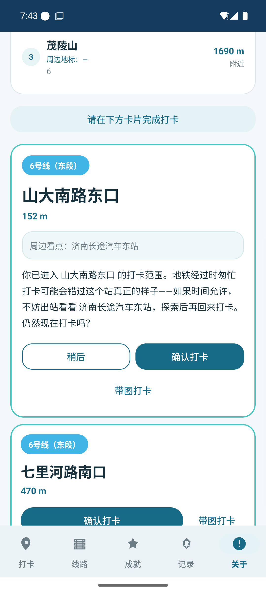
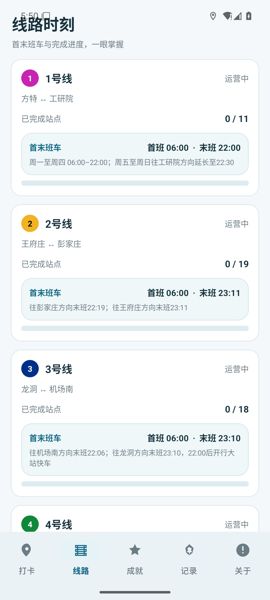
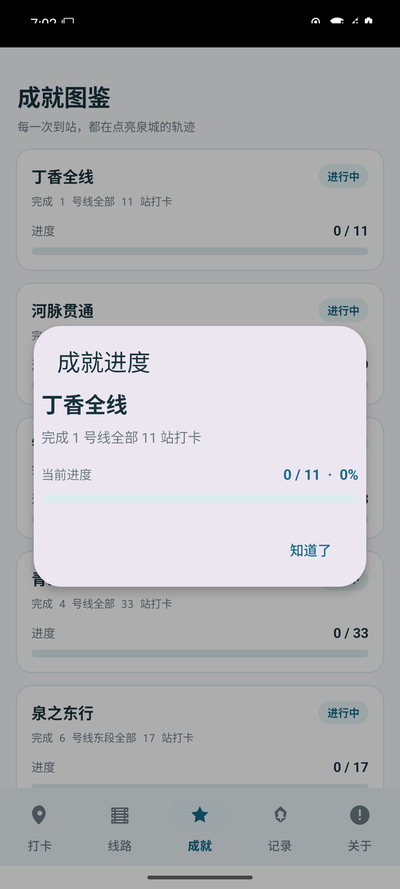
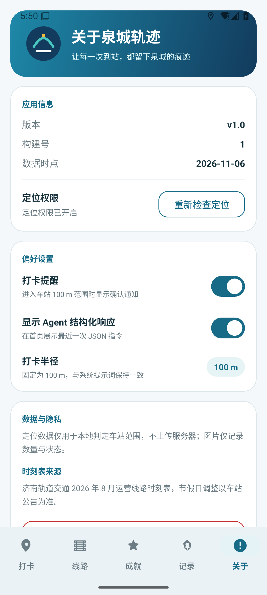

<div align="center">

# 泉城轨迹 QuanchenTrail

### 济南轨道交通打卡 Agent

**把泉城的每一站，走成自己的轨迹**

[](LICENSE)
[](https://www.android.com)
[](https://openjdk.org)
[](https://gradle.org)
[](https://github.com/ba4ihb/Jinan-Metro-Checkin/releases)

<br/>


<br/>


</div>

---

## 目录

- [About 关于](#about-关于)
- [功能特性](#功能特性)
- [应用截图](#应用截图)
- [安装](#安装)
- [构建](#构建)
- [数据来源](#数据来源)
- [项目结构](#项目结构)
- [关键设计](#关键设计)
- [HyperOS 使用提示](#小米澎湃-os--hyperos-使用提示)
- [许可证](#许可证)

---

## About 关于

**泉城轨迹（QuanchenTrail）** 是一款开源的 Android 原生应用，为济南城市轨道交通量身打造的"打卡 Agent"。

济南的轨道交通由**地铁**（1/2/3/4/6/8 号线等）、**济阳线**、**云巴 1 号线**三种制式共同组成，运营主体、时刻表、站点命名各有差异。泉城轨迹把它们统一进同一套打卡判定逻辑里：当你走进某个车站的**打卡半径**（默认 100 m，可在 50–500 m 间调整），App 会自动评估最近的几个车站、周边地标、换乘信息，然后以**页面内卡片**的方式请你确认打卡——不是弹窗，不是重复入口，就是一张卡片。

打卡不是终点。每一次到站都会写入本地数据库，逐步点亮你的**成就图鉴**——完成某条线路的全部车站、打卡全部换乘枢纽、真正乘坐过全部三种制式……成就系统会诚实地记录你的脚步，不会因为一次换乘站打卡就"误以为"你坐过了从没坐过的线路。

<br/>

<table>
<tr>
<td align="center" width="25%">
<br/>
<sub>三线同一套判定</sub>
</td>
<td align="center" width="25%">
<br/>
<sub>一次打卡，多线同步</sub>
</td>
<td align="center" width="25%">
<br/>
<sub>UI 完全一致</sub>
</td>
<td align="center" width="25%">
<br/>
<sub>隐私优先</sub>
</td>
</tr>
</table>

---

## 功能特性

### 🚇 打卡
- 进入车站范围后，最近 3 个车站卡片化展示，标注「可打卡 / 已打卡 / 附近」
- **页面内卡片打卡**：长条提示仅作入口，真正打卡在卡片内完成（「确认打卡 / 带图打卡」）
- **多站同范围**：同时处于多个车站打卡半径内时，每站各出一张卡片，UI 结构完全一致；确认其中一张不会清掉其他卡片
- **同站重复打卡**：每次打卡生成独立 `checkin_group`，历史不被覆盖
- **带图打卡**：可现场拍摄或从图库选择 1–3 张图片，图片复制到应用私有目录

### 🚉 线路与时刻表
- 线路页按官方首末站顺序展示车站与打卡状态
- 首末班车**按方向分条**显示，与官方时刻表原图一致（见 `docs/timetable-source/`）
- 运营状态按当前时间动态判断：运营中 / 休息中 / 未开通

### 🏆 成就系统
- 中文成就说明、进度条、百分比、徽章
- 状态标签颜色区分：**已解锁**（绿色）/ **未解锁**（灰蓝色）
- 跨制式换乘联动打卡**不计入**「全制式行者」等需要真实乘坐某制式的成就判定，避免"打卡一个换乘站就解锁没坐过的线路"的误判

### ⚙️ 其他
- 通知提醒：进入车站范围自动发送系统通知，点击直接跳到卡片
- 关于页：版本、构建号、权限状态、打卡半径滑杆、隐私说明、清除记录
- 开发者测试（仅 Debug）：模拟定位、模拟打卡、状态栏消息测试

---

## 应用截图

| 多站同范围打卡 | 线路时刻表 |
|:---:|:---:|
|  |  |
| 同时处于多个车站打卡半径内时，每站各出一张卡片 | 首末班车按方向分条显示，与官方时刻表一致 |

| 成就图鉴 | 关于与设置 |
|:---:|:---:|
|  |  |
| 线路进度、换乘枢纽、多制式通行等多维度成就 | 版本信息、权限状态、打卡半径调整、隐私说明 |

---

## 安装

下载 [release/QuanchenTrail-v1.0.0-debug.apk](release/QuanchenTrail-v1.0.0-debug.apk)，在 Android 设备上安装即可。

> ⚠️ 当前为 Debug 构建，未签名，仅供体验。正式签名版本将在后续 Release 提供。

首次启动请授予**定位权限**与**通知权限**，否则无法正常打卡。

---

## 构建

### 环境要求
- JDK 17
- Android SDK 35（compileSdk/targetSdk 35，minSdk 26）
- Gradle 8.9（使用项目自带 wrapper）

### 构建命令

```bash
./gradlew.bat assembleDebug
```

运行单元测试与 Lint 检查：

```bash
./gradlew.bat test assembleDebug lintDebug
```

---

## 数据来源

车站、线路、换乘、成就数据位于 `app/src/main/assets/`：
- `stations.json` / `lines.json` / `transfers.json` / `line_station_order.json`
- `achievements.json` / `poi_mapping.json`

首末班车数据按 **2026 年 8 月济南轨道交通运营线路时刻表** 校对，原图见 `docs/timetable-source/`，来源文章：<https://k.sina.com.cn/article_2287707595_885ba5cb02001k4hy.html>

| 线路 | 首班 | 末班 / 方向说明 |
|---|---|---|
| 1 号线 | 06:00 | 周一至周四至 22:00；周五至周日往工研院方向延长至 22:30 |
| 2 号线 | 06:00 | 06:00–22:19；往王府庄方向部分车站末班 23:11 |
| 3 号线 | 06:00 | 往机场南 22:06；往龙洞 23:10，22:00 后有大站快车 |
| 4 号线 | 06:00 | 06:00–22:30 |
| 6 号线东段 | 06:00 | 06:00–22:30；部分反向站点至 23:04 |
| 8 号线 | 06:00 | 周一至周四往清源大街 22:05；周五至周日延长至 22:30 |
| 济阳线 | 06:00 | 往济南东 06:00–20:50；往济阳北 06:30–21:00 |
| 云巴 1 号线 | 06:00 | 内外环均 06:00–22:00 |

---

## 项目结构

```
Jinan-Metro-Checkin/
├── app/src/main/java/com/jnsub/quanchentrail/
│   ├── MainActivity.java          # 主入口、定位与页面调度
│   ├── agent/CheckinAgent.java    # 打卡判定 Agent 协议
│   ├── data/AppDb.java            # SQLite 数据与成就判定
│   ├── ui/                        # Fragment / Adapter / 布局逻辑
│   └── ...
├── app/src/main/res/layout/       # 界面布局
├── app/src/main/assets/           # 线路、车站、成就、POI 数据
├── docs/timetable-source/         # 时刻表原图
├── docs/screenshots/              # 应用截图
├── HANDOVER.md                    # 完整技术交接文档
└── README.md
```

---

## 关键设计

- **打卡入口唯一**：长条提示不可直接打卡，只能通过页面内卡片确认，避免重复弹窗
- **换乘原子联动**：一次打卡写入多条 `checkins`，共享同一 `checkin_group`
- **成就制式判定**：`system_types` 类成就只统计"单一制式"的打卡组，跨制式换乘分组不计入，防止误判解锁
- **版本约束**：`versionCode = 1` / `versionName = 1.0`，请勿随意变更
- **隐私**：定位数据仅用于本地判定车站范围，不上传服务器；图片仅记录数量与状态

---

## 小米澎湃 OS / HyperOS 使用提示

请在系统设置中授予应用**定位权限**、**通知权限**，并将应用加入省电白名单 / 自启动白名单，否则后台定位与通知可能被系统限制。

---

## 许可证

本项目基于 [Apache License 2.0](LICENSE) 开源。

```
Copyright 2026 ba4ihb
```

---

## 致谢

- 时刻表数据来源：济南轨道交通 2026 年 8 月运营线路时刻表
- 图标与视觉：自绘"泉滴 + 轨道"标志，泉城蓝 / 泉水青视觉体系

<div align="center">
<sub>用 ❤️ 打卡济南的每一天</sub>
</div>
